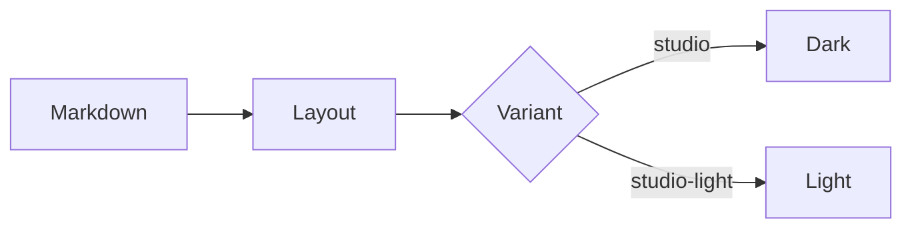

# Studio light

#### One look, five new layouts

---
layout: hero
---

::bg::

<Stage full>
<At :w="1280" :h="720"><Orbit /></At>
</Stage>

::default::

# Slides alive

#### Hero layout: content bottom-left over a live background

---
layout: statement
---

#### The idea

# Say one thing, and say it so big nobody misses it.

---
layout: split
---

# Text left, live right

#### Split layout

Half the slide for the words, half for the thing that moves. A glow marks the seam.

::right::

<Stage :w="640" :h="720">
<At :w="640" :h="720"><Orbit /></At>
</Stage>

---
layout: stage
---

<Stage :w="1200" :h="604">
<At :w="1200" :h="604" bg="var(--nd-surface)"><Orbit /></At>
</Stage>

::caption::

Stage layout: a live component with a caption

---
layout: numbers
---

# Numbers that land

::a::

## 60 fps

Every canvas, every slide

::b::

## 0 ms

Spent fetching a font

::c::

## 13

Layouts in the theme

::d::

## 5

Looks to choose from

---
layout: default
---

# Code, table and diagram

```python {all}
def fade(a, b, t):
    return a + (b - a) * t
```

| Token | Role |
|---|---|
| `--nd-accent` | links and highlights |
| `--nd-accent-2` | the gradient's other end |

> A callout keeps its accent bar.

---
layout: default
---

# Diagram



---
layout: divider
---

# Part two

---
layout: closing
---

# Thank you

#### studio light
