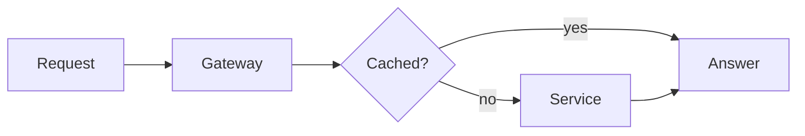

# Harbour review

#### October 2026

#### Quarterly look at the port, the people and the plan

---
layout: agenda
---

# Agenda

1. Where we are
  *Three numbers and what moved them*
2. What shipped
  *Releases, fixes, one retired feature*
3. The numbers
  *Traffic, cost and response time*
4. The people
  *Hiring, rotas and the on-call round*
5. The plan
  *Next quarter in three bets*
6. Risks
  *What could slip, and the fallback*
7. Budget
  *Spend against the forecast*
8. Questions
  *Quiz, then open floor*

---
layout: divider
---

# Part one

---

# What changed

#### Three habits that carried the quarter

- Every release has a written rollback, tested once
- Reviews finish in a day, not a week
- Dashboards show `p95` latency, not the mean
- Incidents end with one change to the system

> Nobody was paged twice for the same cause.

---

# Seven calm habits of very dull releases

#### A subtitle that runs to the limit of fifty-five

- Every release has a written rollback, tested once
- Reviews finish in a day, not a week, whatever the size
- Dashboards show `p95` latency, not the mean latency
- Incidents end with one change to the system itself
- Flags are removed within two weeks of the launch
- Migrations run alone, never inside a release
- Nobody ships on a Friday afternoon, ever

> Nobody was paged twice for the same cause this quarter.

---

# The numbers

#### Median over the last three quarters

| Quarter | Releases | Latency | Cost |
|---|---|---|---|
| Q1 | 14 | 310 ms | 41 k |
| Q2 | 22 | 240 ms | 38 k |
| Q3 | 31 | 180 ms | 36 k |

> Latency is down 42 percent since Q1.

---
layout: two-cols
---

::title::

# Small and boring

::default::

- One config file per service
- Defaults that never surprise
- Errors say what to do next

> Boring is a feature.

::right::

```ts
async function retry(fn, n = 3) {
  try {
    return await fn()
  } catch (err) {
    if (n === 0) throw err
    await sleep(100 * 2 ** (3 - n))
    return retry(fn, n - 1)
  }
}
```

---
layout: photo-right
image: /photo.jpg
---

::title::

# On the water

::default::

- Fourteen berths, all booked
- Two cranes replaced in spring
- Night shift ends at six

---

# From request to answer



---
layout: two-cols
---

::title::

# Traffic and cost

::default::

<Chart type="bar" :labels="['Q1', 'Q2', 'Q3', 'Q4']" :data="[42, 58, 71, 80]" />

::right::

<Chart type="doughnut" :labels="['Web', 'Mobile', 'API', 'Other']" :data="[40, 30, 20, 10]" center="100" legend />

---

# Quick quiz

<Quiz answer="B">
<Choice letter="A">Mean latency</Choice>
<Choice letter="B">The 95th percentile</Choice>
<Choice letter="C">The slowest request</Choice>
<Choice letter="D">Requests per second</Choice>
<Explain letter="B">

The 95th percentile shows what slow users feel, without one outlier moving it.

</Explain>
</Quiz>

---
layout: full
---

<Stage full>
<At :w="1280" :h="720" bg="var(--nd-bg)"><Orbit full /></At>
</Stage>

---
layout: hero
---

::bg::

<Stage full>
<At :w="1280" :h="720"><Aurora /></At>
</Stage>

::default::

# Fair winds

#### A hero slide: the title sits low, over a live background

---
layout: statement
---

#### The idea

# Say one thing, and say it so big that nobody can miss it at all.

---
layout: split
---

# Text left, live right

#### Split layout

Half the slide for the words, half for the thing that moves.

::right::

<Stage :w="640" :h="720">
<At :w="640" :h="720"><Orbit /></At>
</Stage>

---
layout: stage
---

<Stage :w="1200" :h="604">
<At :w="1200" :h="604" bg="var(--nd-surface)"><Orbit /></At>
</Stage>

::caption::

A live component with a caption

---
layout: numbers
---

# Quarter in figures

::a::

## 31

Releases shipped

::b::

## 180 ms

Median latency

::c::

## 36 k

Monthly cost

::d::

## 0

Pages after midnight

---
layout: closing
---

# Thank you

#### questions@harbour.example
